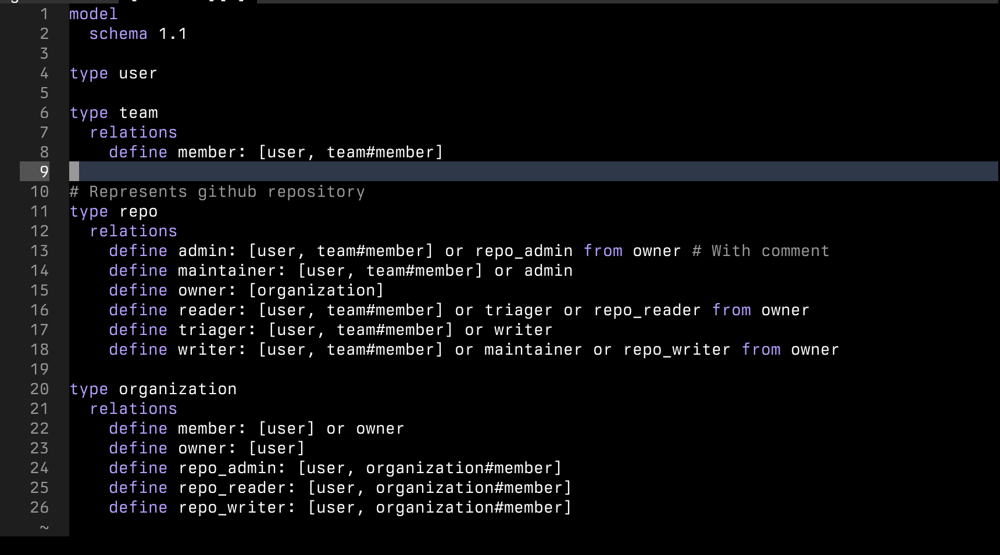

<div align="center">

# tree-sitter-fga

[![CI][ci]](https://github.com/matoous/tree-sitter-fga/actions/workflows/ci.yaml)
<!-- [![crates][crates]](https://crates.io/crates/tree-sitter-fga) -->
<!-- [![npm][npm]](https://www.npmjs.com/package/tree-sitter-fga) -->
<!-- [![pypi][pypi]](https://pypi.org/project/tree-sitter-fga) -->

</div>

A [tree-sitter](https://github.com/tree-sitter/tree-sitter) grammar for [OpenFGA](https://openfga.dev/) authorization schema language.

See https://openfga.dev/docs/configuration-language for the configuration language semantics.



## Development

```sh
npm ci
npm run build
npm run lint
npm test
npm run test:parser
npm run test:upstream
```

`npm test` checks the Node binding and compiles both editor queries.
`npm run test:parser` checks corpus trees and syntax highlighting;
`npm run test:upstream` runs the vendored OpenFGA syntax suite.
For incremental parsing checks, run `npx tree-sitter fuzz --iterations 100`.

See [contribution guidelines](CONTRIBUTING.md) for upstream references, binding checks and the upgrade procedure.

[ci]: https://img.shields.io/github/actions/workflow/status/matoous/tree-sitter-fga/ci.yaml?logo=github&label=CI
[npm]: https://img.shields.io/npm/v/tree-sitter-fga?logo=npm
[crates]: https://img.shields.io/crates/v/tree-sitter-fga?logo=rust
[pypi]: https://img.shields.io/pypi/v/tree-sitter-fga?logo=pypi&logoColor=ffd242
